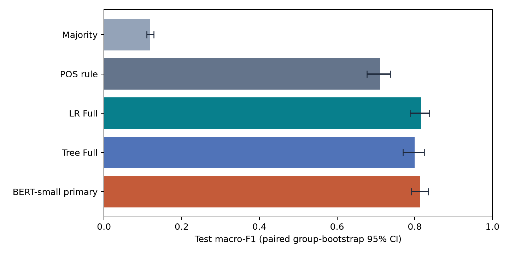

# ESL Grammar Error Classification

[](https://github.com/MihQuannn7799/esl-grammar-error-classification/actions/workflows/ci.yml)
[](pyproject.toml)
[](results/README.md)

A reproducible machine learning study of **five grammar error types in English learner writing**. The project compares linguistic-feature Logistic Regression and Decision Tree models with a fine-tuned BERT-small classifier.

**Input:** an original sentence and an already known error span. **Output:** ArtOrDet, Prep, Nn, Vform, or SVA. A sentence may contain several annotations; each annotation is a separate classification example. Automatic error detection and correction generation are outside this evaluation.

[Run the demo](#quick-start) | [Architecture](docs/ARCHITECTURE.md) | [Results](docs/RESULTS.md) | [Full report](results/reports/final-report.md) | [All documentation](docs/README.md)

## Results at a glance

Evaluated on the same **2,368 test annotations in 97 connected essay groups**:

| Model | Validation Macro-F1 | Test Macro-F1 | Test accuracy |
|---|---:|---:|---:|
| Majority | 0.1184 | 0.1184 | 0.4206 |
| POS rule | 0.7048 | 0.7106 | 0.7441 |
| Logistic Regression, Full | 0.8067 | **0.8163** | 0.8357 |
| Decision Tree, Full | 0.7879 | 0.7996 | 0.8095 |
| BERT-small, primary seed | **0.8173** | 0.8146 | **0.8438** |



BERT's three-seed test mean is **0.8182 +/- 0.0038** (sample standard deviation). Its primary seed is fixed before BERT test scoring. The paired BERT-minus-LR difference is **-0.0017, CI95% [-0.0184, 0.0182]**: the evidence does not establish either model as better.

The BERT extension reused a test already seen for the classical experiments, so this is not independent external validation. See the [result interpretation](docs/RESULTS.md) and [full-precision aggregate tables](results/README.md) for confidence intervals, class tradeoffs, ablations, and limitations.

## Quick start

Requires Git and [uv](https://docs.astral.sh/uv/getting-started/installation/). Run from a Git checkout so preparation tests can record a committed HEAD. Initial dependency installation requires network access.

```bash
git clone https://github.com/MihQuannn7799/esl-grammar-error-classification.git
cd esl-grammar-error-classification
uv sync --locked --python 3.13.7
uv run --no-sync python -m examples.synthetic_demo
uv run --no-sync python -m pytest tests -q
```

The demo uses hand-written examples and the actual feature extractor, train-only encoder, and sparse LR. It needs no NUCLE corpus or task checkpoint, writes no result files, and makes no research-performance claim. The base lock installs spaCy and its English model package.

For the complete test suite, including tiny randomly initialized BERT models:

```bash
uv pip install --python .venv -r requirements-bert.txt
uv run --no-sync python -m pytest tests -q
uv run --no-sync python scripts/check_repository.py
```

The last local full-suite check was **106 passed, 1 skipped**; the skip requires an undistributed licensed corpus fixture. The live badge reports CI status independently. Tests use synthetic inputs and do not download a BERT checkpoint. See [RUNNING.md](docs/RUNNING.md) for training prerequisites and [validation metadata](results/validation.json) for the exact local verification scope.

## What the project demonstrates

- **Data engineering:** SGML parsing, preserved character offsets/provenance, quality checks, and connected-group splitting to reduce content leakage.
- **Feature engineering:** train-only sparse encoding of structure, lexical, POS, morphology, and dependency information; Full has 16,180 columns.
- **Model implementation:** PyTorch sparse multinomial LR with L2/LBFGS and deterministic Gini CART, compared with Majority/POS baselines.
- **Neural experiments:** CLS versus contextual span-mean BERT-small, separate encoder/head learning rates, early stopping, resumable runs, and locked checkpoint selection.
- **Evaluation:** Macro-F1, per-class analysis, incremental/masking/ablation experiments, and 1,000 paired group-bootstrap replicates.

BERT-small has two transformer layers, hidden size 128, and two attention heads. Its input is span-marked text, not the classical feature vector. Full LR already includes sentence-wide dependency information; the comparison is not simply context versus no context.

## Repository structure

```text
src/          Data preparation, features, models, training, and evaluation
examples/     Corpus-free end-to-end demonstration
tests/        Synthetic regression, model, and training-lifecycle tests
configs/      BERT experiment configuration
docs/         Architecture, running instructions, and result interpretation
results/      Aggregate CSVs, figures, and English Markdown reports
scripts/      Lightweight repository checks
.github/      Windows/Linux CI workflow
```

## Explore the work

| Goal | Start here |
|---|---|
| Understand the pipeline and feature encoder | [Architecture](docs/ARCHITECTURE.md) |
| Install, test, or train a new experiment | [Running the project](docs/RUNNING.md) |
| Interpret scores and confidence intervals | [Results and limitations](docs/RESULTS.md) |
| Read the complete study | [Final report: 34 tables and 14 references](results/reports/final-report.md) |
| Inspect the BERT extension | [BERT comparison](results/reports/bert-comparison.md) |
| Present the findings | [Presentation and speaker notes](results/reports/presentation.md) |
| Contribute or run project checks | [Contribution guide](CONTRIBUTING.md) |

## Reproducibility and scope

A fresh checkout supports synthetic tests, the demo, and inspection of saved aggregate results. Full NUCLE reproduction additionally requires independently obtained corpus access, compatible preparation/review inputs, and historical artifacts. Models retain train-fitted weights; validation selects configurations and test is used after locking. Replaying saved predictions is not a new independent evaluation.

The repository excludes corpus text/corrections, row-level predictions, private reviews, checkpoints/vocabularies, caches, report generators, and one-off internal audit/replay helpers. Some retained historical scoring routines require those excluded inputs; follow the public run guide rather than executing them blindly. No pretrained task checkpoint or inference service is distributed.

## Attribution

An academic team project using NUCLE: Dahlmeier, Ng, and Wu (2013), *Building a Large Annotated Corpus of Learner English: The NUS Corpus of Learner English*. Obtain the dataset separately under its applicable terms.

Individual contributions are not inferred from module ownership. AI tools assisted code, tests, analysis, and documentation; the project user ran BERT training/testing commands. AI-assisted language review does not replace independent expert adjudication. Research limitations and pending review are retained in the reports.
