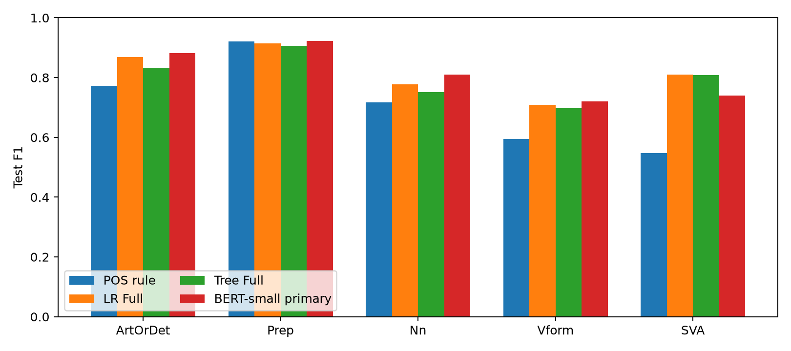

# Results and limitations

The CSVs under [results](../results/README.md) preserve saved aggregate outputs of the completed research study. They were not generated by retraining models during portfolio preparation.

## Model selection

- Train/validation/test: 11,052/2,368/2,368 annotations, split by connected essay groups.
- Full LR: 16,180 features; `C=0.1`, no class weighting.
- Full Tree: depth 8, minimum leaf size 5, no class weighting.
- BERT-small: span-mean readout, encoder LR `5e-5`, head LR `1e-4`; primary seed `20261013` fixed before BERT test.
- BERT selection compares two readouts and two head learning rates over the same three seeds, using mean validation Macro-F1.
- Models retain train-fitted weights; no train+validation refit.

## Main comparison

| Model | Test Macro-F1 | Accuracy | Macro-F1 95% CI |
|---|---:|---:|---|
| Majority | 0.1184 | 0.4206 | [0.1104, 0.1279] |
| POS rule | 0.7106 | 0.7441 | [0.6766, 0.7365] |
| LR Full | 0.8163 | 0.8357 | [0.7876, 0.8382] |
| Tree Full | 0.7996 | 0.8095 | [0.7693, 0.8246] |
| BERT-small primary | 0.8146 | 0.8438 | [0.7919, 0.8350] |

All test rows use the same 2,368 annotations from 97 connected groups. BERT mean ± sample std across three seeds is **0.8182 ± 0.0038**; this does not replace the locked primary run in the paired comparison. Full precision is in [overall_results.csv](../results/overall_results.csv).

The primary metric is Macro-F1 because labels are imbalanced: ArtOrDet accounts for 42.06% of target annotations and Vform for 9.14%. Macro-F1 averages the five class F1 values equally; accuracy counts samples equally.

## Confidence intervals

Intervals use 1,000 paired connected-group bootstrap replicates. The same group resample is applied to each model, preserving within-group dependence and enabling direct CIs for differences.

| Comparison | Δ Macro-F1 | CI95% |
|---|---:|---|
| LR − Tree | +0.0166 | [0.0018, 0.0301] |
| LR − POS | +0.1057 | [0.0829, 0.1288] |
| BERT primary − LR | −0.0017 | [−0.0184, 0.0182] |
| BERT primary − Tree | +0.0149 | [−0.0049, 0.0378] |

BERT–LR and BERT–Tree CIs contain zero. That is insufficient evidence to rank these models confidently; it does not establish equivalence. Inspect paired difference intervals rather than overlap of separate model CIs. These are pointwise intervals on one split, without simultaneous multiple-comparison adjustment. They do not measure training-seed or split variation.

## Feature analysis and class tradeoffs

Classical incremental experiments show a clear benefit from adding POS to structure/lexical inputs. Removing all lexical features reduces LR test Macro-F1 by about 0.0281, CI95% [0.0142, 0.0394]; masking lexical identity only within the span reduces it by about 0.0134, CI95% [0.0049, 0.0201]. These variants have separately selected hyperparameters under the same within-model grid, so differences describe pipelines rather than isolated causal effects of a feature.

Masked span lexical features and completely nonlexical features answer different questions: masking retains lexical context, while nonlexical removes the entire L family. Removing explicit P/M also does not remove all related information that may remain in dependency features.

BERT improves four class F1 values relative to LR but is weaker on SVA: **0.7392 versus 0.8106**. For Nn, BERT obtains **0.8098 versus LR's 0.7781**. This explains why BERT's accuracy is higher while primary Macro-F1 is slightly lower.

## Negative results and diagnostics

The first BERT-small benchmark achieved validation Macro-F1 about 0.1984 ± 0.0030 across three seeds. Small-set diagnostics showed that the model could memorize 100 train examples, but memorization did not establish generalization. The later extension changed both readout and training settings; improvement cannot be attributed to span mean alone.

Forty BERT/LR audit cases were selected by disagreement/control buckets, with AI-assisted notes. This was a purposeful sample, not a random estimate of corpus error prevalence. The consolidated expert-review queue has 22 IDs; gold labels remain unchanged, and independent language adjudication is pending. Row-level corpus material and audit notes are not distributed here.

## Limits of the evidence

- The input assumes an already known error span. There is no end-to-end detection/correction evaluation.
- BERT extension decisions occurred after classical test results were known. It reuses that test rather than an independent external set.
- There is one grouped split; bootstrap does not cover alternate splits or training randomness.
- Parser mistakes, wide/partial-token spans, and ambiguous annotations can affect results; the audit does not prove causal explanations.
- The original clean-environment replay covered 52 classical final-stage fits, not every historical search or BERT retraining.
- This public export does not include licensed text, private review inputs, task checkpoints, row-level predictions, or historical report generators. It cannot independently recreate the original source/artifact lock.
- Deployment latency, operating costs, educational benefit, and generalization to other corpora were not measured.
