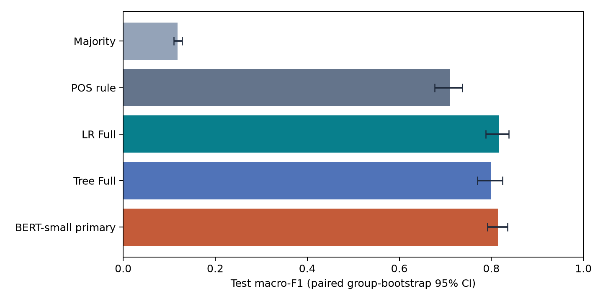
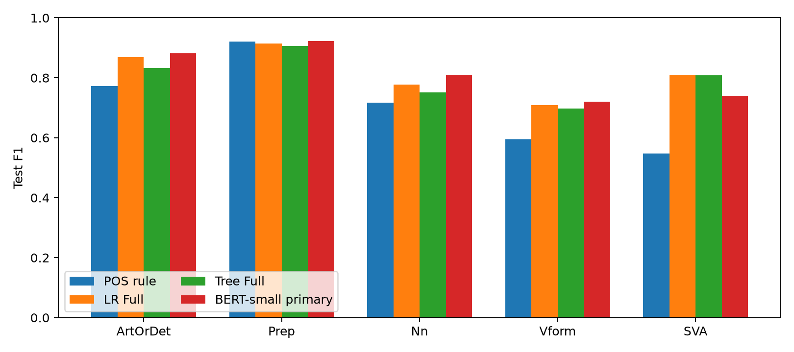

# BERT-small: Extended Results and Comparison with Baselines

**Research snapshot:** October 28, 2026. **English Markdown edition:** October 31, 2026.

This report replaces the three-page Vietnamese BERT comparison PDF. It translates the original interpretation, retains both quantitative tables and two figures, and adapts links to the public portfolio. Calculations refer to saved predictions; models, gold labels, and the primary seed are unchanged. No additional training or test scoring was performed for this conversion.

## Training and configuration selection

The extension consists of 12 runs: two readouts (CLS and span mean), two head learning rates (1e-4 and 1e-3), and three seeds. Encoder learning rate stays at 5e-5. Each run allows up to 20 epochs, stopping after four consecutive epochs without sufficient validation improvement.

Span mean with head learning rate 1e-4 is selected by the highest mean validation Macro-F1. Primary seed 20261013 is fixed before viewing BERT test. Checks of selection, inputs, source, checkpoints, and saved predictions all agree: 61 checks passed.

All models use the same 2,368 test samples and 97 connected essay groups. Confidence intervals use the same 1,000 group-bootstrap replicates, so model differences are evaluated on paired resamples. Seed standard deviation is reported separately because it addresses a different source of variation.

## Test results

| Model | Val F1 | Test F1 | Accuracy | CI95% |
| --- | --- | --- | --- | --- |
| Majority | 0.1184 | 0.1184 | 0.4206 | [0.1104; 0.1279] |
| POS rule | 0.7048 | 0.7106 | 0.7441 | [0.6766; 0.7365] |
| LR Full | 0.8067 | 0.8163 | 0.8357 | [0.7876; 0.8382] |
| Tree Full | 0.7879 | 0.7996 | 0.8095 | [0.7693; 0.8246] |
| BERT-small primary | 0.8173 | 0.8146 | 0.8438 | [0.7919; 0.8350] |

Primary BERT obtains test Macro-F1 0.8146 and accuracy 0.8438. Mean across three seeds is 0.8182 +/- 0.0038. The best test seed is not substituted for the primary; doing so would make selection depend on test.

| Contrast | Delta F1 | CI95% |
| --- | --- | --- |
| BERT primary - LR Full | -0.0017 | [-0.0184; 0.0182] |
| BERT primary - Tree Full | 0.0149 | [-0.0049; 0.0378] |
| BERT primary - POS rule | 0.1040 | [0.0785; 0.1343] |
| BERT primary - Majority | 0.6962 | [0.6702; 0.7175] |

BERT-minus-LR and BERT-minus-Tree intervals contain zero. The evidence is insufficient to conclude BERT is better or worse than either, and it does not prove equivalence. The interval over POS lies above zero, supporting improvement in that particular comparison.

Intervals are pointwise on one locked split. The BERT extension occurs after classical test results were known. This is an additional comparison on the same test, not independent external validation.

## Important differences

Both LR and BERT are correct on 1,860 test examples. BERT alone is correct on 138, LR alone on 119, and both are wrong on 251. BERT improves four class F1 values but is weaker on SVA: 0.7392 versus LR 0.8106. For Nn, BERT obtains 0.8098 versus LR 0.7781. These tradeoffs explain higher BERT accuracy alongside slightly lower primary Macro-F1.

For closer inspection, the audit selects 40 cases: 12 BERT-wrong/LR-correct, 12 reverse-direction cases, 10 both-wrong cases, and six both-correct controls. Six gold-SVA examples are prioritized in the first group. IDs are selected before reading sentences/corrections. Gold labels and spans match source SGML in all 40 cases.

Every case has AI-assisted notes; human review/contribution fields remain unfilled at the reporting snapshot. The sample is purposeful: traversal of sorted buckets yields nine ArtOrDet and one Nn in the both-wrong group. Frequencies in this packet cannot estimate corpus prevalence. Notes establish neither causal explanations nor independent expert adjudication.

Some spans are fragments; some missing words are anchored to existing neighboring text. Other cases need closer examination of the label/correction relationship. Expert priorities include IDs 23037, 34539, 16809, 30366, 32801, and 32874. A partial-token case correctly classified by both models is retained as a control, avoiding the claim that every fragment causes failure.

Original sentences, corrections, and per-case review CSVs remain on the research machine and are not distributed in this repository. Gold labels are unchanged after test. The consolidated queue has 22 distinct pending expert-review IDs.

## Reading and rechecking the results

Public aggregate evidence:

- [overall_results.csv](../overall_results.csv) and [per_class_metrics.csv](../per_class_metrics.csv): overall/class-specific results.
- [validation_grid.csv](../validation_grid.csv) and [seed_results.csv](../seed_results.csv): configuration selection and seed outcomes.
- [paired_differences.csv](../paired_differences.csv): primary BERT comparisons and confidence intervals.
- [validation.json](../validation.json): public-code validation scope, distinct from the 61 historical BERT checks.
- [export_manifest.json](../export_manifest.json): hashes for this public edition, distinct from historical research source manifests.

The research analysis also used bootstrap weights, row-level predictions, private audit packets, and verification manifests that are excluded here. Its analysis script can write a fresh output with compatible historical inputs, but aggregate CSVs alone do not recreate the paired bootstrap. Language review is a judgment process, not a deterministic metric recomputation. Follow [RUNNING.md](../../docs/RUNNING.md) for the actual public workflow.

At the classical research snapshot, four source files were missing and two prediction CSVs had changed formatting. In-memory normalization reproduced the original hashes, and metric/CI recomputation agreed, but the old workspace did not pass the original lock unchanged. Historical manifests were preserved. Neither this report's conversion nor the public export constitutes verification of that historical lock.
