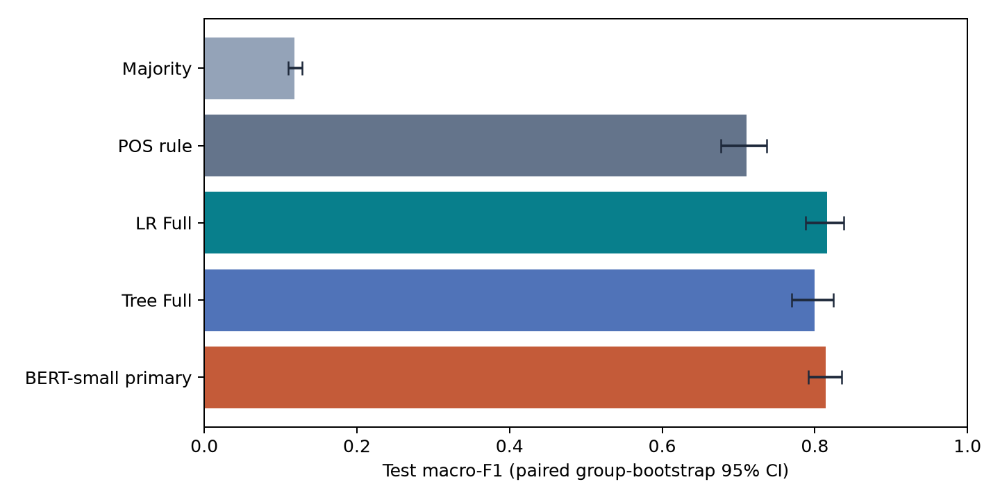
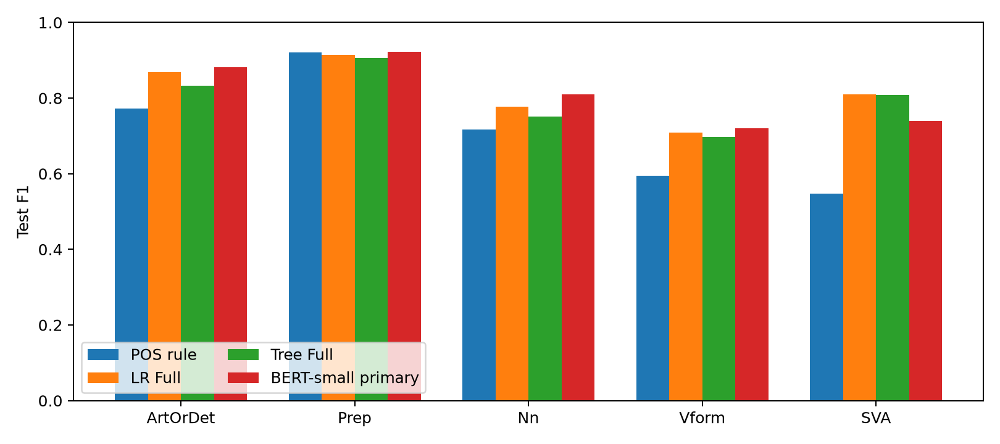
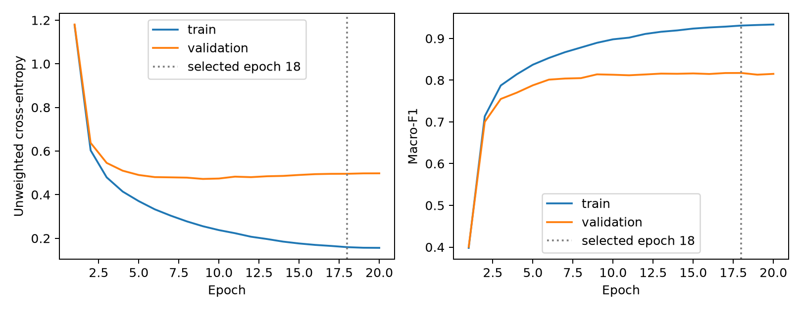
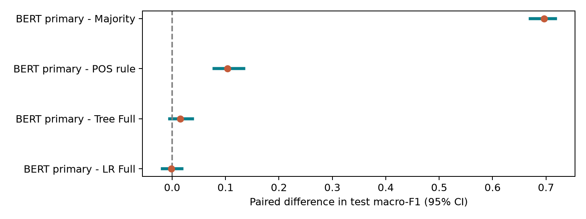

# Final Project Report

## Five-Class Grammar Error Classification on NUCLE

Original sentence and known error span | Linguistic features | Logistic Regression | Decision Tree | BERT-small

**Research results updated:** October 28, 2026. **English Markdown edition:** October 31, 2026.

This edition replaces the Vietnamese PDF in the portfolio. It retains all 34 research tables, including complete configuration/result appendices. The prose is translated and formatted for Markdown; selected published figures and repository links are adapted to the public export. Historical private artifacts are described as evidence, not implied to be distributed. No model training, additional test predictions, or gold-label changes were performed for this conversion.

## Abstract

The project classifies grammatical error types when their locations in English learner sentences are already known. Each annotation has one of five labels: ArtOrDet, Prep, Nn, Vform, or SVA. From 44,912 annotations in 1,397 NUCLE essays, preparation retains 15,788 target samples in 11,272 sentences. Connected groups keep related essays together to reduce leakage: 11,052 train, 2,368 validation, and 2,368 test samples.

Full Logistic Regression (LR) obtains test Macro-F1 0.8163, Full Decision Tree 0.7996, POS rule 0.7106, and Majority 0.1184. LR exceeds Tree by 0.0166, CI95% [0.0018, 0.0301], and POS by 0.1057, CI95% [0.0829, 0.1288]. Ablations support lexical/POS usefulness within the tested pipelines. Additional morphology/dependency benefits vary by model and comparison.

Initial BERT-small validation Macro-F1 is 0.1984 +/- 0.0030. The extension tests alternative readouts, separate encoder/head learning rates, and longer training with validation-based stopping. Selected span mean obtains validation 0.8183 +/- 0.0011 and test 0.8182 +/- 0.0038 over three seeds. The predeclared primary achieves test F1 0.8146 and accuracy 0.8438. BERT minus LR is -0.0017, CI95% [-0.0184, 0.0182], insufficient to rank them confidently.

Nn/ArtOrDet and Vform/SVA are prominent confusions. Wide spans, multiple edits, and missing words anchored to nonempty spans complicate interpretation. Historical clean-environment replay reproduces 52 classical final-stage fits and saved test predictions. Language analysis is AI-assisted; 22 consolidated IDs still need expert review. Observations are separated from untested explanations.

## Reading conventions

A span is the target character interval. Validation selects configurations/checkpoints; test evaluates locked choices. A seed controls stochastic behavior; a checkpoint stores model state. Scores use a 0-1 scale; 0.01 is one percentage point. BERT's +/- denotes sample standard deviation across seeds, not bootstrap CI. N/A means empty or ineligible, not zero performance.

Tables retain original displayed numeric values. Check headline scores in [overall_results.csv](../overall_results.csv) and classical results in [classical_ablations.csv](../classical_ablations.csv). Historical `test_scored=false` fields describe artifact creation before scoring, not an absence of completed test evaluation.

## 1. Problem and research questions

Each sample is one annotation, so two errors in one sentence can yield two differently labeled samples. Input is `(sentence, error_start, error_end, error_span)`; output is one of five types. Error positions are supplied externally. Detection, rewriting, and learner feedback generation are outside the evaluation. Corrections are used only for data review and post-prediction interpretation.

**Table 1. Target taxonomy**

| Label | Meaning |
| --- | --- |
| ArtOrDet | Article or determiner |
| Prep | Preposition |
| Nn | Noun number |
| Vform | Verb form |
| SVA | Subject-verb agreement |

**Table 2. Research questions**

| RQ | Question | Evidence |
| --- | --- | --- |
| RQ1 | How well do LR/Tree perform relative to Majority/POS? | Test, per-class metrics, paired bootstrap |
| RQ2 | How do lexical/POS/morphology/dependency features contribute? | Incremental features, masking, nonlexical, P/M/D removal |
| RQ3 | Which confusions remain and what properties accompany them? | Confusions, span/POS slices, ID-based review |

The pipeline traces source annotations to predictions while preserving offsets and provenance. LR, Tree, and baselines share experimental conditions across feature variants. Both negative initial BERT results and the extension remain visible. Case review complements quantitative analysis without editing gold after test.

## 2. Research context and related work

NUCLE [REF01] supplies annotations. CoNLL-2013 [REF02] and the GEC survey [REF03] provide context. This five-class Macro-F1 is not directly comparable to correction-system F0.5 or explanation-quality scores because tasks, inputs, and evaluation targets differ.

**Table 3. Related work used and comparison limits**

| Source | Input -> output | Data/evaluation | Use and limits |
| --- | --- | --- | --- |
| [REF01, NUCLE](https://aclanthology.org/W13-1703/) | Learner essays -> error annotations | Learner English corpus | Dataset/taxonomy source, not a classification baseline. |
| [REF04, Davis 2022](https://aclanthology.org/2022.conll-1.25/) | Contextual tokens -> error detection | SVA knowledge probe | Motivates SVA-specific analysis; detection differs from five-class span classification. |
| [REF07, LET](https://aclanthology.org/2023.findings-acl.371/) | Sentence -> token error types and corrected sentence | ERRANT/GEC benchmarks; F0.5 | Motivates error types; GEC F0.5 is not directly comparable with this Macro-F1. |
| [REF08, MoECE](https://aclanthology.org/2024.findings-emnlp.997/) | Sentence -> correction; router predicts error type | GEC with error-type loss and ablation | Informs ablation design; mixture of experts is not implemented. |
| [REF09, GEE!](https://aclanthology.org/2024.findings-naacl.49/) | Error/correction pair -> edit explanation | Explanation quality evaluation | Application context only; corrections are not predictor inputs. |
| [REF10, Coyne 2025](https://arxiv.org/abs/2508.06810) | Supplied upstream annotations -> feedback | Learning feedback | Oracle annotations do not demonstrate this classifier capability. |
| [REF11, Nagata 2022](https://aclanthology.org/2022.findings-acl.324/) | Contextual tokens -> correctness or synthetic error type | Learner binary / synthetic multiclass tasks | Motivates BERT; its five synthetic classes differ from NUCLE; span markers are a project adaptation. |
| [REF12, Koyama 2025](https://aclanthology.org/2025.acl-long.1026/) | Minimal sentence pairs -> correction by phenomenon | Teacher-built CTSEG | Motivates grammatical slices; NUCLE slices are not CTSEG. |
| [REF13, SERCL](https://aclanthology.org/2020.conll-1.7/) | Parses of erroneous/corrected sentences -> edit class | Structural edit classification | Informs linguistic features; differs from original-sentence-only classification. |
| [REF14, BERT](https://aclanthology.org/N19-1423/) | Contextual tokens/subwords -> representation/task head | Pretraining then fine-tuning | Model foundation, not a guarantee of beating LR. |
| [REF15, parser robustness](https://aclanthology.org/D16-1182/) | Erroneous/corrected sentences -> parse comparison | Parser robustness | Motivates parser review; another parser does not establish spaCy error rates. |

LET [REF07] and MoECE [REF08] motivate explicit error-type information and ablations. GEE! [REF09] uses error/correction pairs; Coyne et al. [REF10] study feedback with upstream annotations supplied. Neither shares this classifier's input contract. Nagata et al. [REF11], BERT [REF14], and compact-model pretraining [REF20] motivate contextual representations. Koyama et al. [REF12] support phenomenon-specific evaluation. SERCL [REF13] and parser robustness [REF15] inform linguistic-feature limitations.

This discussion inherits project-reviewed sources, not a new systematic review or completed PRISMA process. LET, mixture-of-experts, XGEC, and SHAP were not implemented. Screened sources unused in the argument remain outside the main references.

## 3. Data, quality, and preprocessing

**Table 4. Dataset scope**

| Measure | Value |
| --- | --- |
| All source annotations | 44912 |
| Essays with annotations | 1397 |
| Source error types | 28 |
| Five-class annotations | 15788 |
| Essays with at least one target error | 1355 |
| Prepared v2 input sentences | 11272 |
| Out-of-scope annotations | 29124 |
| Unconstructible target samples | 0 |

**Table 5. Overall and partition-specific label distribution**

| Label | All | Percentage (%) | Train | Validation | Test |
| --- | --- | --- | --- | --- | --- |
| ArtOrDet | 6640 | 42.06 | 4648 | 996 | 996 |
| Prep | 2413 | 15.28 | 1689 | 362 | 362 |
| Nn | 3768 | 23.87 | 2638 | 565 | 565 |
| Vform | 1443 | 9.14 | 1011 | 216 | 216 |
| SVA | 1524 | 9.65 | 1066 | 229 | 229 |

ArtOrDet is 42.06% of target samples, about 4.60 times Vform. Always predicting it gives accuracy 42.06% but Macro-F1 0.1184. Macro-F1 weights classes equally for selection. Validation and test have matching class counts by design but distinct essays/groups.

**Table 6. Quality flags; flags do not establish annotation errors**

| Quality flag | All annotations | Target annotations |
| --- | --- | --- |
| invalid_offset | 0 | 0 |
| cross_paragraph | 4 | 0 |
| missing_label | 0 | 0 |
| missing_correction | 0 | 0 |
| no_op | 30 | 6 |
| empty_edit | 0 | 0 |
| long_span | 387 | 2 |
| same_span_different_label | 47 | 11 |
| duplicate_candidate | 0 | 0 |
| overlapping_span | 531 | 170 |

There are 455 overlapping-span pairs in the entire source; pair counts differ from flagged-annotation counts. Flags can co-occur, so summing them does not count bad samples. No invalid offsets or missing corrections were found. All four cross-paragraph annotations are outside the target taxonomy. Target data retain six no-op, 170 overlap, 11 same-span/different-label, and two long-span annotations. Flags alone do not justify deletion/relabeling.

### 3.1. Offset preservation and preparation v1 to v2

Offsets are Python string indices in half-open intervals `[start, end)`, not SGML byte offsets. The invariant is `sentence[error_start:error_end] == error_span`. Stopwords, punctuation, articles, and original whitespace are not silently removed. Tokens intersect when `token_start < error_end` and `error_start < token_end`. Partial-token spans keep their character interval and use overlapping tokens for linguistic representation.

**Table 7. Preparation v2 alignment**

| Alignment | Samples | Percentage (%) |
| --- | --- | --- |
| exact | 14447 | 91.51 |
| partial_token | 1130 | 7.16 |
| whitespace_edge | 211 | 1.34 |

V2 adds text-only boundaries for citations, abbreviations, ellipses, and punctuation attached to words, without consulting gold/corrections. Relative to v1, 544/15,788 samples change input (3.45%), 533 change sentence ID, 30 change context, and two change span tokenization. Sentence count rises from 11,262 to 11,272. Source offsets/provenance stay fixed; no target sample is lost. Boundary IDs 31297/39538 remain unresolved, separate from 96 unresolved quality-review annotations.

No target span is empty. Mechanical edit statistics count 12,821 replacements and 2,967 deletions, but nonempty source/correction pairs can still represent insertion around or inside a span. Later audit identifies 16/40 insertion-only corrections under its fixed token comparison. Zero empty spans therefore does not imply zero missing-word errors.

### 3.2. Grouped split and duplicate control

**Table 8. Connected-group split**

| Partition | Samples | Essays | Groups | Percentage (%) |
| --- | --- | --- | --- | --- |
| test | 2368 | 144 | 97 | 15.00 |
| train | 11052 | 1069 | 1045 | 70.00 |
| validation | 2368 | 142 | 99 | 15.00 |

Related essays are connected before splitting with seed 20261013 and 70/15/15 targets. All 1,397 essays form 1,280 groups; the largest has 34 essays/338 target samples. The target-bearing subset has 1,355 essays/1,241 groups, so partition totals do not cover all source essays. Seven boilerplate groups are exempt under fixed rules and contain no targets. No essay/group crosses partitions. The policy reduces checked duplicate leakage without excluding every semantic near-duplicate.

## 4. Features and implemented models

**Table 9. Five feature families**

| Family | Information | Full dimensions |
| --- | --- | --- |
| S | Sentence/span length, relative position, span kind | 9 |
| L | Lexical slots and span/context unigrams/bigrams | 9194 |
| P | POS signature, alignment, slots, local pattern | 6068 |
| M | Number, Person, Tense, VerbForm | 31 |
| D | Dependency, head, subject, morphology/POS relations | 878 |

Full has 16,180 columns. Lexical information covers the span and up to two tokens on each side; dependency uses whole-sentence parsing. Numeric features keep their scale without z-scoring. The 500-term cap applies only to pooled n-grams; positional lexical slots have separate vocabularies. The train-only encoder handles unknown/missing values. Gold, corrections, IDs, and review decisions are not predictors. LR thus has some context beyond the local lexical window.

### 4.1. Majority and POS rule

Majority predicts the train-majority label. POS rule fixes ADP -> Prep and DET -> ArtOrDet, learns train-majority labels for other signatures, and falls back to Majority for unseen signatures. Whole-span signatures and slice `primary_upos` are processed separately.

### 4.2. Multinomial Logistic Regression

```text
p(y=k | x) = exp(x^T w_k + b_k) / sum_j exp(x^T w_j + b_j)
prediction = argmax_k p(y=k | x)
J(W,b) = sum_i alpha(y_i) * [-log p(y_i | x_i)] / sum_i alpha(y_i)
         + ||W||^2 / (2 * C * n_train)
```

Balanced weighting uses `alpha(k)=n_train/(5*n_k)`; otherwise alpha=1. Bias is not L2-regularized. Implementation uses sparse COO PyTorch/LBFGS with strong-Wolfe search, not sklearn LogisticRegression. Final settings: max_iter 1,000; max_eval 1,250; gradient tolerance 1e-6; change tolerance 1e-9; 10 CPU threads; seed 20261013. Eligible `change_tolerance` stopping does not imply the gradient threshold was reached. Runs reaching iteration/evaluation limits are ineligible under the protocol.

### 4.3. Decision Tree

Custom deterministic CART uses `Gini(t)=1-sum_k p_k^2` and weighted impurity reduction. In balanced mode, weights affect impurity/gain; leaf predictions use majority raw counts. Depth/minimum leaf size constrain complexity. These details distinguish the implementation from other tree estimators.

## 5. Experimental design and metrics

**Table 10. Search grids and selection budget**

| Item | Setting |
| --- | --- |
| LR | C={0.01,0.1,1,10} x class_weight={None,balanced}: 8 configurations/variant |
| Tree | depth={4,8,12} x min_leaf={5,20} x class_weight: 12 configurations/variant |
| Criterion | Highest validation Macro-F1; LR must be eligible; ties follow grid order |
| Final evaluation stage | 40 new Full-minus-P/M grid fits + 12 historical refits = 52 fits |
| Alias | Full-minus-D = S+L+P+M; 18 LR/Tree names but 16 distinct checkpoints |
| Final fit | Keep train-fitted model; no train+validation refit |
| Test | 20 names including Majority/POS; 18 distinct predictors after aliases |

Span masking removes identities of tokens intersecting the span before fitting a separate train-only encoder. It keeps original context and POS/morphology/dependency parses, and does not join context into artificial cross-span bigrams. Nonlexical removes all L. Removing P/M/D deletes that named family, but related information may remain elsewhere. Every variant is tuned separately: differences compare pipelines under a budget, not isolated causal feature effects.

```text
Precision_k = TP_k / (TP_k + FP_k)
Recall_k    = TP_k / (TP_k + FN_k)
F1_k        = 2*TP_k / (2*TP_k + FP_k + FN_k)
Macro-F1    = sum_k F1_k / K
```

Accuracy is the correct fraction. Zero denominators yield zero; empty subsets are N/A. Whole-test/span bins use K=5. Gold-label pairs and POS slices average their two fixed gold classes while retaining five-class predictions, so out-of-pair predictions still create false negatives.

Classical selection locks at 2026-10-23 08:39:33 UTC; test begins 08:39:42 UTC. Historical lock SHA-256: `2f2f9fd1ff19805255f300d4eaf646aa964e3e643ce692027f528ba5b9c198ee`. Configurations, encoder, code, and inputs are hashed before scoring. No test-based reselection or annotation changes are made.

### 5.1. Group confidence intervals

Dependent examples are resampled by connected group rather than independent row. B=1,000, bootstrap seed 20261023, G=97 test groups; every selected group contributes all its annotations. Shared weights across models enable paired comparisons: `C(b,m)=sum_g w(b,g)*C(g,m)` and `Delta(b)=F1(C(b,A))-F1(C(b,B))`. CI95% uses percentiles 2.5 and 97.5.

Subset CIs require at least 20 samples, 10 groups, both relevant gold classes, and at least 950/1,000 valid replicates. Label sets stay fixed when classes are absent; empty replicates are excluded/count-recorded. Intervals are pointwise without simultaneous multiple-comparison correction. They do not measure training-seed/split variation or guarantee new-corpus performance.

## 6. Test results

**Table 11. Main validation/test benchmark**

| Model | Val F1 | Test F1 | Test CI95% | Accuracy | Macro P | Macro R |
| --- | --- | --- | --- | --- | --- | --- |
| Majority | 0.1184 | 0.1184 | [0.1104; 0.1279] | 0.4206 | 0.0841 | 0.2000 |
| POS rule | 0.7048 | 0.7106 | [0.6766; 0.7365] | 0.7441 | 0.7387 | 0.7184 |
| LR Full | 0.8067 | 0.8163 | [0.7876; 0.8382] | 0.8357 | 0.8271 | 0.8073 |
| Tree Full | 0.7879 | 0.7996 | [0.7693; 0.8246] | 0.8095 | 0.8064 | 0.7937 |
| BERT-small primary | 0.8173 | 0.8146 | [0.7919; 0.8350] | 0.8438 | 0.8221 | 0.8094 |

The BERT row is primary seed 20261013. Test mean over three seeds is 0.8182 +/- 0.0038; the best test seed never replaces the primary.



**Table 12. Paired differences between headline models**

| Comparison | Delta Macro-F1 | CI95% |
| --- | --- | --- |
| LR Full - Majority | 0.6978 | [0.6655; 0.7212] |
| Tree Full - Majority | 0.6812 | [0.6470; 0.7073] |
| LR Full - Tree Full | 0.0166 | [0.0018; 0.0301] |
| LR Full - POS | 0.1057 | [0.0829; 0.1288] |
| BERT primary - LR Full | -0.0017 | [-0.0184; 0.0182] |
| BERT primary - Tree Full | 0.0149 | [-0.0049; 0.0378] |
| BERT primary - POS rule | 0.1040 | [0.0785; 0.1343] |
| BERT primary - Majority | 0.6962 | [0.6702; 0.7175] |

LR leads classical models, exceeding Tree by 1.66 percentage points and POS by 10.57 points of Macro-F1, with paired CIs above zero. BERT-versus-LR/Tree intervals contain zero, leaving their ranking uncertain. Inspect paired intervals rather than overlap of separate model CIs. LR test F1 exceeds validation by about 0.0096; that reflects different datasets, not a post-test improvement.

**Table 13. Full LR test precision, recall, and F1**

| Label | Support | Precision | Recall | F1 |
| --- | --- | --- | --- | --- |
| ArtOrDet | 996 | 0.8366 | 0.9046 | 0.8693 |
| Prep | 362 | 0.9239 | 0.9061 | 0.9149 |
| Nn | 565 | 0.8184 | 0.7416 | 0.7781 |
| Vform | 216 | 0.7387 | 0.6806 | 0.7084 |
| SVA | 229 | 0.8178 | 0.8035 | 0.8106 |

**Table 14. Class F1 of headline models**

| Label | Majority | POS rule | LR Full | Tree Full | BERT primary |
| --- | --- | --- | --- | --- | --- |
| ArtOrDet | 0.5922 | 0.7731 | 0.8693 | 0.8329 | 0.8823 |
| Prep | 0.0000 | 0.9212 | 0.9149 | 0.9065 | 0.9218 |
| Nn | 0.0000 | 0.7170 | 0.7781 | 0.7519 | 0.8098 |
| Vform | 0.0000 | 0.5946 | 0.7084 | 0.6979 | 0.7198 |
| SVA | 0.0000 | 0.5470 | 0.8106 | 0.8090 | 0.7392 |



Overall LR superiority does not apply to every label: Prep F1 is 0.9212 for POS versus 0.9149 for LR. POS is a strong preposition baseline, while LR improves same-POS discrimination. Nn recall 0.7416 means about 25.84% of Nn samples are assigned elsewhere. Smaller classes and label boundaries need separate inspection.

## 7. Feature contributions

**Table 15. Complete validation/test ablation results**

| Variant | LR val | LR test | Tree val | Tree test |
| --- | --- | --- | --- | --- |
| S+L | 0.7164 | 0.7203 | 0.5832 | 0.5850 |
| S+L+P | 0.7956 | 0.7968 | 0.7548 | 0.7520 |
| S+L+P+M | 0.8048 | 0.8102 | 0.7929 | 0.7967 |
| Full | 0.8067 | 0.8163 | 0.7879 | 0.7996 |
| Mask lexical span | 0.8016 | 0.8028 | 0.7876 | 0.8006 |
| No L | 0.7964 | 0.7881 | 0.7862 | 0.7894 |
| Full−P | 0.8001 | 0.7982 | 0.7711 | 0.7811 |
| Full−M | 0.8015 | 0.8123 | 0.7751 | 0.7826 |
| Full−D (alias) | 0.8048 | 0.8102 | 0.7929 | 0.7967 |

**Table 16. Incremental and ablation paired intervals**

| Comparison | Delta test F1 | CI95% |
| --- | --- | --- |
| LR S+L+P minus S+L | 0.0766 | [0.0581; 0.0975] |
| LR S+L+P+M minus S+L+P | 0.0134 | [-0.0004; 0.0256] |
| LR Full minus S+L+P+M | 0.0060 | [-0.0054; 0.0191] |
| LR Full minus Full_mask_span_lexical | 0.0134 | [0.0049; 0.0201] |
| LR Full minus S+P+M+D_nonlexical | 0.0281 | [0.0142; 0.0394] |
| LR Full minus Full_minus_P | 0.0181 | [0.0069; 0.0296] |
| LR Full minus Full_minus_M | 0.0040 | [-0.0066; 0.0136] |
| LR Full minus Full_minus_D | 0.0060 | [-0.0054; 0.0191] |
| Tree S+L+P minus S+L | 0.1670 | [0.1400; 0.1897] |
| Tree S+L+P+M minus S+L+P | 0.0447 | [0.0275; 0.0648] |
| Tree Full minus S+L+P+M | 0.0029 | [-0.0077; 0.0124] |
| Tree Full minus Full_mask_span_lexical | -0.0010 | [-0.0117; 0.0086] |
| Tree Full minus S+P+M+D_nonlexical | 0.0103 | [-0.0014; 0.0205] |
| Tree Full minus Full_minus_P | 0.0186 | [0.0049; 0.0328] |
| Tree Full minus Full_minus_M | 0.0171 | [0.0008; 0.0360] |
| Tree Full minus Full_minus_D | 0.0029 | [-0.0077; 0.0124] |

POS adds the largest incremental gain over S+L: LR +0.0766 [0.0581, 0.0975] and Tree +0.1670 [0.1400, 0.1897]. This fits a taxonomy associated with word classes but does not establish POS sufficiency: Full LR still exceeds POS rule by 0.1057.

Removing all L reduces LR F1 by 0.0281 [0.0142, 0.0394]; masking span lexical identity reduces it by 0.0134 [0.0049, 0.0201]. Nonlexical also removes neighboring lexical context, so neither difference measures pure word memorization. Masked Tree obtains 0.8006 versus Full 0.7996, but the difference CI contains zero; the selected Full is not replaced by a test-winning variant.

Removing P reduces LR by 0.0181 and Tree by 0.0186, with positive Full-minus-ablated CIs. Morphology has clearer evidence for Tree: 0.0171 [0.0008, 0.0360], versus LR 0.0040 [-0.0066, 0.0136]. Dependency CIs contain zero for both models. Insufficient stable-improvement evidence is not proof of uselessness: feature overlap and finite test size remain possible explanations.

## 8. Error analysis and difficult subsets

**Table 17. Largest Full LR confusion directions**

| Gold -> prediction | Cases | % of LR errors | % of gold support |
| --- | --- | --- | --- |
| Nn → ArtOrDet | 134 | 34.45 | 23.72 |
| ArtOrDet → Nn | 59 | 15.17 | 5.92 |
| Vform → SVA | 29 | 7.46 | 13.43 |
| Vform → Nn | 20 | 5.14 | 9.26 |
| ArtOrDet → Prep | 19 | 4.88 | 1.91 |
| Vform → ArtOrDet | 18 | 4.63 | 8.33 |
| SVA → Vform | 18 | 4.63 | 7.86 |
| Prep → ArtOrDet | 15 | 3.86 | 4.14 |

LR makes 389 errors among 2,368 examples. Nn <-> ArtOrDet accounts for 193/389 (49.61%); Vform <-> SVA for 47/389 (12.08%). Together they represent 61.70% of LR errors, not linguistic-cause or annotation-error prevalence.

**Table 18. Test span-bin and gold-label/POS subsets**

| Subset | n | Groups | Majority F1 | POS F1 | LR F1 | Tree F1 |
| --- | --- | --- | --- | --- | --- | --- |
| empty | 0 | 0 | N/A | N/A | N/A | N/A |
| single_token | 2102 | 97 | 0.1154 | 0.7173 | 0.8320 | 0.8145 |
| multi_token | 266 | 57 | 0.1405 | 0.4921 | 0.5370 | 0.4489 |
| Vform/SVA | 445 | 76 | 0.0000 | 0.6095 | 0.8021 | 0.7959 |
| Vform/SVA@VERB | 220 | 64 | 0.0000 | 0.3548 | 0.8416 | 0.8412 |
| Vform/SVA@AUX | 105 | 44 | 0.0000 | 0.4670 | 0.8477 | 0.8677 |
| Vform/SVA@NOUN | 37 | 21 | 0.0000 | 0.0000 | 0.1667 | 0.1071 |
| Vform/SVA@DET | 1 | 1 | 0.0000 | 0.0000 | 0.0000 | 0.0000 |
| Nn/ArtOrDet | 1561 | 95 | 0.3895 | 0.7663 | 0.8453 | 0.8148 |
| Nn/ArtOrDet@VERB | 33 | 22 | 0.4500 | 0.0000 | 0.3864 | 0.4843 |
| Nn/ArtOrDet@AUX | 3 | 3 | 0.2500 | 0.0000 | 0.0000 | 0.0000 |
| Nn/ArtOrDet@NOUN | 682 | 86 | 0.2431 | 0.4044 | 0.8142 | 0.7028 |
| Nn/ArtOrDet@DET | 343 | 64 | 0.4827 | 0.4827 | 0.4827 | 0.4827 |

Span bins use five-class Macro-F1; pair slices average two fixed gold classes. Scores cannot be summed/averaged across slices to infer overall F1.

**Table 19. Eligible LR-minus-POS slice intervals**

| Subset | Delta F1 | CI95% |
| --- | --- | --- |
| single_token | 0.1147 | [0.0886; 0.1406] |
| multi_token | 0.0449 | [-0.0401; 0.1262] |
| Vform/SVA | 0.1927 | [0.1407; 0.2394] |
| Vform/SVA@VERB | 0.4867 | [0.4214; 0.5405] |
| Vform/SVA@AUX | 0.3807 | [0.1145; 0.4900] |
| Vform/SVA@NOUN | 0.1667 | [0.0400; 0.2895] |
| Nn/ArtOrDet | 0.0790 | [0.0463; 0.1195] |
| Nn/ArtOrDet@VERB | 0.3864 | [0.2500; 0.4706] |
| Nn/ArtOrDet@NOUN | 0.4098 | [0.3555; 0.4685] |
| Nn/ArtOrDet@DET | 0.0000 | [0.0000; 0.0000] |

Multi-token LR-minus-POS is +0.0449, CI [-0.0401, 0.1262], so stable improvement is unestablished. Vform/SVA@VERB improves +0.4867 [0.4214, 0.5405]: knowing a target is a verb is insufficient to distinguish form/agreement. Nn/ArtOrDet@NOUN improves +0.4098 [0.3555, 0.4685]. Nn/ArtOrDet@DET has zero difference. Improvements are uneven; interpret small slices using n/groups rather than overreading zero/one scores.

### 8.1. Language audit and interpretation limits

The classical audit has 25 LR errors, five Tree errors where LR is correct, and 10 LR-correct controls. Seeded purposeful selection precedes correction inspection. All 40 cases are rechecked against source, offsets, corrections, tokens, and features. This is AI-assisted review, not expert-independent adjudication or a representative random corpus sample.

**Table 20. Difficult patterns observed in the audit**

| Pattern | Illustrative IDs | Qualified interpretation |
| --- | --- | --- |
| Missing word, nonempty span | 38087, 24747, 17826 | Anchor POS differs from the missing word; visible-token heuristics can mislead. |
| Partial token | 17814 | Valid offsets; enclosing token is ADP while character edit concerns noun number. |
| Wide span / multiple edits | 19312, 34483, 32904 | One label covers several signals; span is not necessarily a minimal edit. |
| Parser output needing review | 24526, 9351, 41235, 35455, 211 | Automatic POS/morphology may mismatch context; causal attribution remains untested. |
| Indirect subject | 36821, 17311 | Subject is attached to a head; extractor reads direct target children only. |
| Ambiguous gold/edit | 34539, 12324, 26635, 32705, 37909 | Requires adjudication; retain original gold and scoring. |
| LR correct, POS wrong | 11916, 44353, 6079 | LR may use signals beyond anchor POS; gold agreement alone does not prove understanding. |

The earlier expert queue contains 17 cases: seven prominent label/edit ambiguities, two structural-scope cases, two context-dependent determiner cases, and six suspected parser cases. This does not establish 17 wrong annotations. Empty corrections at IDs 26635/37909 are genuine deletions, not parser loss. Difficult examples were not removed to inflate test performance.

**Table 21. LR ArtOrDet-minus-Nn logit decomposition for ID 6079**

| Component | Contribution |
| --- | --- |
| S | −0.0422 |
| L | +1.6728 |
| P | −0.8141 |
| M | +0.3155 |
| D | −0.1921 |
| Intercept | +0.1070 |
| Total | +1.0470 |

The positive total agrees with LR preferring ArtOrDet to Nn while POS predicts Nn. Positive lexical contribution outweighs negative POS contribution in this decomposition. This explains one checkpoint algebraically, not causal feature importance or complete understanding of the missing word.

### 8.2. Additional post-test BERT/LR audit

Full-test overlap: both correct 1,860; BERT alone correct 138; LR alone correct 119; both wrong 251. These counts differ in meaning from the purposefully selected audit frequencies.

The extension audits 40 examples: 12 BERT-wrong/LR-correct, 12 reverse-direction cases, 10 both-wrong, and six both-correct controls. Six gold-SVA examples are prioritized in the first bucket. Seed 20261028 selects IDs before sentence/correction inspection. All 40 gold/spans match SGML. AI notes exist for each; human review/contribution fields are unfilled at the reporting snapshot. Bucket traversal yields nine ArtOrDet and one Nn in the both-wrong group, limiting prevalence interpretation.

SVA examples motivate examining clausal subjects and coordinated verb chains. Missing words may anchor to nouns, verbs, or fragments, so substring POS does not uniquely determine type. IDs 23037, 34539, 16809, 30366, 32801, and 32874 are prioritized for expert review. Gold stays fixed. No direct experiment attributes disagreement to attention, POS, or truncation. Both models correctly classify partial-token ID 38155, showing fragments do not invariably cause errors.

Corpus text/corrections and notes remain private. Merging the earlier queue and new priorities gives 22 distinct pending IDs.

## 9. BERT-small: initial experiment, diagnostics, and extension

Checkpoint: `google/bert_uncased_L-2_H-128_A-2`, revision `30b0a37ccaaa32f332884b96992754e246e48c5f`: two layers, hidden size 128, two heads, about 4.39 million parameters, not BERT-base. Markers `[SPAN_START]`/`[SPAN_END]` bracket the target. Left/span/right are tokenized separately; max_length 128 keeps the entire target. Five train/six validation examples lose context; no target is truncated. Encoder and classifier are fine-tuned.

The initial phase uses pooled CLS, dropout/classifier, cross-entropy, batch 32, five epochs, AdamW, weight decay 0.01 excluding bias/LayerNorm, 10% warmup, linear decay, clipping 1, and four CPU threads. Learning rates 3e-5/5e-5 run on the first seed; the selected rate runs on two more seeds. Validation selects checkpoints without choosing the best representative seed. This phase has no BERT test score.

**Table 22. Initial BERT validation fine-tuning runs**

| Learning rate | Seed | Selected epoch | Macro-F1 | Runtime seconds |
| --- | --- | --- | --- | --- |
| 3e-05 | 20261013 | 5 | 0.1706 | 213.4 |
| 5e-05 | 20261013 | 5 | 0.2003 | 205.5 |
| 5e-05 | 20261014 | 5 | 0.1999 | 209.6 |
| 5e-05 | 20261015 | 4 | 0.1949 | 196.9 |

**Table 23. Initial validation comparison**

| Model | n | Macro-F1 | Accuracy |
| --- | --- | --- | --- |
| Majority | 2368 | 0.1184 | 0.4206 |
| LR Full (saved) | 2368 | 0.8067 | 0.8463 |
| Tree Full | 2368 | 0.7879 | 0.8142 |
| POS rule | 2368 | 0.7048 | 0.7576 |
| Tree S+L+P+M | 2368 | 0.7929 | 0.8264 |
| BERT-small seed 20261013 | 2368 | 0.2003 | 0.4535 |
| BERT-small seed 20261014 | 2368 | 0.1999 | 0.4341 |
| BERT-small seed 20261015 | 2368 | 0.1949 | 0.4282 |

Selected-rate BERT obtains 0.1984 +/- 0.0030 across three seeds. Primary 0.2003 is 0.6064 below LR validation. It predicts 1,828 ArtOrDet, 538 Nn, two Prep, and no Vform/SVA; Prep/Vform/SVA F1 are zero. Accuracy 0.4535 barely exceeds Majority and does not show five-class capability. Seed std is not a CI and is not combined with test bootstrap.

### 9.1. Optimization and span-use diagnostics

**Table 24. Gradient/update probes by source/readout**

| Source / readout | Embedding norm | Encoder layer0 norm | Layer1 norm | Classifier norm | Start-marker change after one step |
| --- | --- | --- | --- | --- | --- |
| pretrained_cls | 0.654593 | 0.307446 | 0.235027 | 0.512786 | 0.000566 |
| pretrained_span_mean | 0.865756 | 0.575860 | 0.352035 | 0.841210 | 0.000566 |
| saved_failed_run_cls | 6.074696 | 2.479423 | 1.680808 | 2.182717 | 0.000566 |
| saved_failed_run_span_mean | 3.937057 | 1.633337 | 1.107149 | 1.935566 | 0.000566 |

**Table 25. Marker relocation with the earlier encoder**

| Readout with earlier encoder | Changed predictions | Mean probability L1 | Mean representation cosine |
| --- | --- | --- | --- |
| cls | 28/100 | 0.3481 | 0.7959 |
| span_mean | 11/100 | 0.3497 | 0.5967 |

**Table 26. Memorization of 100 selected training examples**

| Readout | Learning rate | First observed 100% accuracy | Final update | Final accuracy | Final CE | Strict criterion |
| --- | --- | --- | --- | --- | --- | --- |
| cls | 5e-05 | 175 | 400 | 100.0% | 0.1515 | CE <= 0.05 not reached |
| cls | 0.001 | 50 | 100 | 100.0% | 0.0073 | Passed |
| span_mean | 0.001 | 50 | 75 | 100.0% | 0.0104 | Passed |

Probes cover pretrained/failed models: loss matches independent cross-entropy, optimizer parameter coverage is complete, no missing/NaN/Inf gradients appear, and marker/encoder/classifier parameters update. Zero direct gradient at final-layer target hidden states under CLS is the expected readout structure; earlier self-attention gradients remain. It is not evidence of a broken learning path.

Moving markers changes CLS predictions on 28/100 train examples: sensitivity does not prove correct localization. In 50 selected same-sentence pairs with differently labeled targets, CLS changes in seven pairs and gets both correct in two. This purposeful train stress test is not new validation evaluation.

CLS 5e-5 reaches 100% train accuracy but CE 0.1515, failing CE <= 0.05. CLS 1e-3/span mean 1e-3 pass after 100/75 updates. These probes change dropout, weight decay, schedule, and example exposure versus full fine-tuning. Neither LR nor readout alone is established as the cause of the original failure. Small-set optimization is possible; generalization still requires separate evaluation.

### 9.2. October 28 extension

The split, pretrained revision, and span-preservation policy remain fixed. Four configurations combine CLS/span mean with head LR 1e-4/1e-3 and encoder LR 5e-5, each on the same three seeds. Runs allow 20 epochs, patience 4, min_delta 0.0001, batch 32, max_length 128, AdamW, dropout 0.1, weight decay 0.01, warmup 10%, clipping 1. Pooler/classifier use head LR; embeddings/transformer use encoder LR.

Each run restarts from pretrained, not a memorization checkpoint. Train/validation are evaluated after each epoch in eval mode. Highest validation-F1 checkpoint is kept; ties prefer earlier epochs.

**Table 27. Extension grid: validation mean/std over three seeds**

| Readout | Encoder LR | Head LR | Val F1 mean | Sample std |
| --- | --- | --- | --- | --- |
| cls | 5e-05 | 0.0001 | 0.7164 | 0.0061 |
| cls | 5e-05 | 0.001 | 0.7227 | 0.0147 |
| span_mean | 5e-05 | 0.0001 | 0.8183 | 0.0011 |
| span_mean | 5e-05 | 0.001 | 0.8177 | 0.0022 |

Span mean/head LR 1e-4 wins at 0.8183 +/- 0.0011. Primary remains 20261013. Its epoch-18 checkpoint has train F1 0.9309 and validation 0.8173, leaving a substantial generalization gap. Best validation checkpoint, not the last optimizer state, is evaluated.



**Table 28. Three locked seeds on the same test**

| Seed | Selected epoch | Val F1 | Test F1 | Test accuracy |
| --- | --- | --- | --- | --- |
| 20261013 | 18 | 0.8173 | 0.8146 | 0.8438 |
| 20261014 | 14 | 0.8182 | 0.8177 | 0.8450 |
| 20261015 | 14 | 0.8195 | 0.8222 | 0.8471 |

Test mean is 0.8182 +/- 0.0038. Seed 20261015 gets 0.8222 but does not replace primary after test. Primary is 0.8146 [0.7919, 0.8350]. BERT-minus-LR is -0.0017 [-0.0184, 0.0182]; BERT-minus-Tree +0.0149 [-0.0049, 0.0378]; BERT-minus-POS +0.1040 [0.0785, 0.1343]. The first two do not establish ranking; the last supports improvement in this pointwise comparison.



BERT SVA F1 0.7392 is below LR 0.8106; Nn 0.8098 exceeds LR 0.7781. Accuracy 0.8438 versus 0.8357 does not imply higher Macro-F1. Mean/std across BERT seeds does not replace its primary paired comparison against one classical seed.

BERT selection precedes BERT test, but occurs after classical test results were known. It reuses that test, not an independent external evaluation. Configurations remain fixed after BERT test; future work should use a new external test.

## 10. Verification, reproducibility, and trustworthiness

**Table 29. Historical saved verification results**

| Item | Historical result |
| --- | --- |
| SGML understanding | 44,912 annotations / 1,397 essays; no CSV cell differences |
| Quality/duplicate evidence | Audit CSV byte-identical; duplicate inventory content matches |
| Preparation v2 | All 7 data outputs byte-identical, including 15,788 samples/provenance |
| Grouping/split | split_manifest.csv and essay_groups.csv byte-identical; no essay/group leakage |
| NLP/features | 11,272 sentences parsed; 15,788 vectors / 16,180 dimensions; features/targets/train-only encoder byte-identical |
| Training | 52 fits: 40 Full-minus-P/M grid fits and 12 historical refits; settings/metrics/termination match |
| Checkpoints | 18 LR/Tree names include 2 aliases; 16 distinct checkpoints content-identical |
| Test replay | 20 named pipelines x 2,368 examples; zero prediction differences; all metrics/subsets retained |
| Independent arithmetic | 280 model-slice metrics, 40 F1 CIs, 30 difference CIs match; all 1,000 bootstrap replicates recalculated |
| Reports/CSV | 16 DOCX/Markdown tables equal; 11 quantitative tables match artifacts; 240 CSV rows checked |
| Isolated-environment tests | 13 passed; no failures; library warnings do not change outcomes |
| ID review | 40/40 match source, offsets, correction, tokens, P/M/D; seeded selection reproduces IDs |

Historical pipeline replay took 13.89 minutes in an isolated environment: Python 3.13.7, NumPy 2.5.3, PyTorch 2.14.0+cpu, spaCy 3.8.7, en_core_web_sm 3.8.0, without system-site-packages. Seven preparation outputs match byte-for-byte; 11,272 sentences yield 15,788 vectors/16,180 columns. Fifty-two fits match configurations, metrics, and termination; 16 checkpoints match by content, and 20 named pipelines' 2,368 predictions match. These are saved historical results, not runs performed for this conversion.

Independent arithmetic review checks 280 model/slice metrics, 40 F1 CIs, 30 difference CIs, and all 1,000 replicates. Earlier approximate validation baseline entries differ by at most about 3.32e-8, without changing four-decimal conclusions.

Fixed-config v1/v2 sensitivity changes LR validation about 0.8069 to 0.8078 at four threads; the original 10-thread baseline is 0.8067. LBFGS/thread numerical-sensitivity checks reproduce two differing predictions. The higher refit score does not replace baseline. This small preprocessing change has no CI and does not establish stable model improvement.

Replay covers raw input, features, 52 final-stage fits, and test replay. Review logs and selected configurations of six earlier variants remain fixed inputs; the full historical grid and BERT retraining were not replayed. Same-test reproduction adds no independent-test evidence. Corpus, vocabularies, task checkpoints, and private inputs are outside this portfolio; see [running instructions](../../docs/RUNNING.md).

### 10.1. BERT verification and workspace limitations

The extension passes 61 selection/source/input/checkpoint/saved-prediction checks. Bootstrap reuses the exact historical 1,000-by-97 weight matrix and reproduces classical CIs. These read saved results rather than produce additional test predictions. A separate 23-test synthetic scope covers tokenization, readouts, train-lock-test lifecycle, resume, and group bootstrap. It differs from both the raw-to-52-fit replay and the public full test suite.

Numerical consistency differs from byte integrity. At the research snapshot, 69/74 classical lock entries match: four reporting generators are deleted, validation CSV padding changes, and test CSV differs from scoring hash. In-memory normalization recovers original CSV hashes; matching source backups exist in a historical ZIP. Metrics remain verified, but that workspace does not pass the old `verify_lock`. Historical locks are not rewritten.

The portfolio deliberately excludes report generators, internal review/replay helpers, corpus, and task checkpoints. Its export manifest describes the public edition, not the research lock. English Markdown conversion does not change these reproducibility limits.

## 11. Discussion and conclusions

**Table 30. Answers to the research questions**

| RQ | Evidence-bounded conclusion | Limit |
| --- | --- | --- |
| RQ1 | LR Full test F1 0.8163; positive paired CIs over Tree/POS. BERT primary 0.8146; BERT-minus-LR CI contains zero. | One grouped split; one classical seed; known spans, not end-to-end GEC. |
| RQ2 | POS improves S+L strongly; lexical benefits LR; clearer morphology benefit for Tree. | Variants separately tuned; feature overlap; LR M/D CIs contain zero. |
| RQ3 | Nn/ArtOrDet and Vform/SVA dominate errors; LR exceeds POS in important same-POS slices. | Purposeful AI-assisted review; descriptive associations do not establish causes. |

Full LR is a useful reference: strong F1, sparse representation, and decomposable logit contributions. Span-mean BERT offers a contextual alternative with similar observed performance, not established statistical superiority. Standardized latency/memory were not measured; timings across different experiments describe execution, not controlled deployment cost.

The strongest feature evidence concerns POS and lexical gains in declared comparisons. LR's incremental morphology/dependency benefits are less conclusive. Zero-containing CIs may reflect redundancy, extractor limitations, or finite data; the experiments do not distinguish these explanations.

Both BERT phases remain relevant: results depend on readout/training recipe. LR already uses sentence-wide dependency information, so this is not context versus no context. The extension compares readouts under a shared grid but does not isolate all changes between phases.

### 11.1. Limitations and future work

**Table 31. Limitations and follow-up directions**

| Limitation | Consequence | Follow-up |
| --- | --- | --- |
| Gold span supplied | Does not measure detection or correction | Evaluate detection-to-classification on new data if scope expands. |
| One classical split/seed | CI omits training/split variation | Predeclare multiple seeds/splits or a new external test. |
| Parser/taxonomy | Representation or label issues may explain some errors | Expert review of 17 original cases; version adjudicated gold separately. |
| Direct-child subject only | Misses subject links through auxiliary/head/conjunction | Controlled subject-inheritance extractor, evaluated on new data. |
| One small BERT; classical test already seen | Similar scores do not establish equivalence of contextual models | New external test, preregistered design, no tuning on observed test. |
| Many pointwise CIs | No simultaneous guarantees | Predeclare fewer primary contrasts or correct multiple comparisons. |
| Private source inputs | Checkout alone cannot reproduce the full study | Maintain clear guides, hashes, environment, and access requirements. |

The study connects annotation preparation, training, validation selection, testing, and analysis into a traceable workflow. Lexical/syntactic LR is a strong baseline on this split; span-mean BERT is close without a decisive paired difference. Remaining errors concern span representation, context, and label boundaries. The evidence does not establish complete grammatical understanding, sentence correction, or generalization across learner corpora.

## Appendix A. Selected configurations and full results

**Table 32. All named LR/Tree configurations**

| ID | Variant | Dimensions | Configuration |
| --- | --- | --- | --- |
| LR_00 | S+L | 9203 | {"C": 1.0, "class_weight": null} |
| Tree_00 | S+L | 9203 | {"max_depth": 12, "min_samples_leaf": 5, "class_weight": null} |
| LR_01 | S+L+P | 15271 | {"C": 1.0, "class_weight": null} |
| Tree_01 | S+L+P | 15271 | {"max_depth": 12, "min_samples_leaf": 5, "class_weight": null} |
| LR_02 | S+L+P+M | 15302 | {"C": 1.0, "class_weight": null} |
| Tree_02 | S+L+P+M | 15302 | {"max_depth": 12, "min_samples_leaf": 5, "class_weight": "balanced"} |
| LR_03 | S+L+P+M+D | 16180 | {"C": 0.1, "class_weight": null} |
| Tree_03 | S+L+P+M+D | 16180 | {"max_depth": 8, "min_samples_leaf": 5, "class_weight": null} |
| LR_04 | Full_mask_span_lexical | 16180 | {"C": 0.1, "class_weight": null} |
| Tree_04 | Full_mask_span_lexical | 16180 | {"max_depth": 12, "min_samples_leaf": 5, "class_weight": "balanced"} |
| LR_05 | S+P+M+D_nonlexical | 6986 | {"C": 1.0, "class_weight": null} |
| Tree_05 | S+P+M+D_nonlexical | 6986 | {"max_depth": 8, "min_samples_leaf": 20, "class_weight": "balanced"} |
| LR_06 | Full_minus_P | 10112 | {"C": 1.0, "class_weight": null} |
| Tree_06 | Full_minus_P | 10112 | {"max_depth": 8, "min_samples_leaf": 5, "class_weight": "balanced"} |
| LR_07 | Full_minus_M | 16149 | {"C": 0.1, "class_weight": null} |
| Tree_07 | Full_minus_M | 16149 | {"max_depth": 12, "min_samples_leaf": 5, "class_weight": "balanced"} |
| LR_08 | Full_minus_D | 15302 | {"C": 1.0, "class_weight": null} |
| Tree_08 | Full_minus_D | 15302 | {"max_depth": 12, "min_samples_leaf": 5, "class_weight": "balanced"} |

Full-minus-D aliases S+L+P+M for each model; pipeline names do not count distinct checkpoints.

**Table 33. All 20 final named results, with CIs and aliases**

| ID | Val F1 | Test F1 | Test CI95% | Alias |
| --- | --- | --- | --- | --- |
| Majority | 0.1184 | 0.1184 | [0.1104; 0.1279] | — |
| POS | 0.7048 | 0.7106 | [0.6766; 0.7365] | — |
| LR_00 | 0.7164 | 0.7203 | [0.6875; 0.7467] | — |
| Tree_00 | 0.5832 | 0.5850 | [0.5601; 0.6052] | — |
| LR_01 | 0.7956 | 0.7968 | [0.7659; 0.8195] | — |
| Tree_01 | 0.7548 | 0.7520 | [0.7193; 0.7774] | — |
| LR_02 | 0.8048 | 0.8102 | [0.7775; 0.8349] | — |
| Tree_02 | 0.7929 | 0.7967 | [0.7674; 0.8201] | — |
| LR_03 | 0.8067 | 0.8163 | [0.7876; 0.8382] | — |
| Tree_03 | 0.7879 | 0.7996 | [0.7693; 0.8246] | — |
| LR_04 | 0.8016 | 0.8028 | [0.7758; 0.8245] | — |
| Tree_04 | 0.7876 | 0.8006 | [0.7727; 0.8252] | — |
| LR_05 | 0.7964 | 0.7881 | [0.7598; 0.8108] | — |
| Tree_05 | 0.7862 | 0.7894 | [0.7572; 0.8170] | — |
| LR_06 | 0.8001 | 0.7982 | [0.7700; 0.8204] | — |
| Tree_06 | 0.7711 | 0.7811 | [0.7533; 0.8032] | — |
| LR_07 | 0.8015 | 0.8123 | [0.7850; 0.8347] | — |
| Tree_07 | 0.7751 | 0.7826 | [0.7512; 0.8060] | — |
| LR_08 | 0.8048 | 0.8102 | [0.7775; 0.8349] | LR_02 |
| Tree_08 | 0.7929 | 0.7967 | [0.7674; 0.8201] | Tree_02 |

[Classical full-precision CSV](../classical_ablations.csv) retains aggregate outputs. The headline table uses later verified validation values; small historical rounding differences do not change displayed conclusions.

## Appendix B. Code and evidence map

**Table 34. Research workflow modules and public-export scope**

| Modules / historical component | Role and portfolio scope |
| --- | --- |
| src/data/nucle_sgml.py, parse_nucle.py | SGML parsing, annotation table, offset checks |
| data_understanding.py, data_quality.py | Statistics and missing/no-op/overlap/duplicate quality checks |
| prepare_nucle.py, sentence_boundaries.py, boundary_challenges.py | Preparation v1/v2, invariants, boundary flags |
| group_split_nucle.py, compare_preparation.py | Connected-group split and preparation comparison |
| src/features/nucle_pos.py, nucle_features.py | POS baseline and train-only S/L/P/M/D encoding |
| src/models/nucle_logistic.py, nucle_tree.py | Sparse LR and deterministic Gini Tree |
| src/training/nucle_benchmark.py, nucle_ablation.py, nucle_final_selection.py | Grid, ablation, refit, validation selection, locking |
| src/training/bert_span_classifier.py; models/bert_span_readout.py | Span-marked BERT and CLS/span-mean readouts |
| src/evaluation/nucle_final_evaluation.py, metrics.py | Scoring, group bootstrap, subset metrics; shared code retained |
| Historical private review/replay helpers | Arithmetic/source review and raw-to-prediction replay; omitted from portfolio |
| Historical document generators/notebooks | Research report/figure generation and snapshots; omitted from portfolio |
| tests/ | Synthetic invariants, features/models, metrics, bootstrap, serialization/lifecycle checks |

Public aggregates/figures/reports are under [results](../README.md). Corpus text/corrections are omitted; IDs and qualitative descriptions support discussion without reproducing the corpus. Historical research manifests retain their snapshot meaning; this public portfolio is not that locked workspace. Historical evidence mentioned here is not necessarily distributed.

## Appendix C. Contributions, handover, and AI assistance

Classical evaluation and historical verification are complete within Section 10's scope. BERT completes 12 runs, selects span mean by validation, and tests three seeds: primary F1 0.8146; mean/std 0.8182 +/- 0.0038. Earlier phase documents remain historical snapshots.

Names and individual assignments were not supplied at the reporting snapshot. Contributions must be supported by actual code, logs, reviews, or analyses rather than inferred from module lists or team-wide outcomes. The portfolio invents neither individual authorship nor submission confirmation.

AI tools assist code, tests, analysis, and editing; the project user runs BERT train/test commands. AI-assisted language review is not independent expert adjudication. Hashes, recomputed metrics, and joins validate technical properties, not every linguistic judgment. Merging 17 earlier cases with six priorities after overlap removal leaves 22 pending IDs; gold stays fixed.

For interviews, contributors should explain a real sample's input, feature/encoding, prediction/gold; the group split; one personally inspected error; and a small check they understand. Administrative submission and contribution confirmation remain team responsibilities.

## References

[REF01] Dahlmeier, D., Ng, H. T., & Wu, S. M. (2013). **Building a Large Annotated Corpus of Learner English: The NUS Corpus of Learner English.** Proceedings of the Eighth Workshop on Innovative Use of NLP for Building Educational Applications, 22–31. [ACL Anthology](https://aclanthology.org/W13-1703/).

[REF02] Ng, H. T., Wu, S. M., Wu, Y., Hadiwinoto, C., & Tetreault, J. (2013). **The CoNLL-2013 Shared Task on Grammatical Error Correction.** Proceedings of the Seventeenth Conference on Computational Natural Language Learning: Shared Task, 1–12. [ACL Anthology](https://aclanthology.org/W13-3601/).

[REF03] Bryant, C., Yuan, Z., Qorib, M. R., Cao, H., Ng, H. T., & Briscoe, T. (2023). **Grammatical Error Correction: A Survey of the State of the Art.** Computational Linguistics, 49(3), 643–701. [DOI/publisher](https://doi.org/10.1162/coli_a_00478).

[REF04] Davis, C., Bryant, C., Caines, A., Rei, M., & Buttery, P. (2022). **Probing for targeted syntactic knowledge through grammatical error detection.** Proceedings of the 26th Conference on Computational Natural Language Learning, 360–373. [ACL Anthology](https://aclanthology.org/2022.conll-1.25/).

[REF07] Yang, L., Li, H., Li, L., Xu, C., Xia, S., & Yuan, C. (2023). **LET: Leveraging Error Type Information for Grammatical Error Correction.** Findings of the Association for Computational Linguistics: ACL 2023, 5986–5998. [ACL Anthology](https://aclanthology.org/2023.findings-acl.371/).

[REF08] Qorib, M. R., Aji, A. F., & Ng, H. T. (2024). **Efficient and Interpretable Grammatical Error Correction with Mixture of Experts.** Findings of the Association for Computational Linguistics: EMNLP 2024. [ACL Anthology](https://aclanthology.org/2024.findings-emnlp.997/).

[REF09] Song et al. (2024). **GEE! Grammar Error Explanation with Large Language Models.** Findings of the Association for Computational Linguistics: NAACL 2024. [ACL Anthology](https://aclanthology.org/2024.findings-naacl.49/).

[REF10] Coyne et al. (2025). **Annotating Errors in English Learners’ Written Language Production: Advancing Automated Written Feedback Systems.** arXiv:2508.06810, author manuscript. [arXiv](https://arxiv.org/abs/2508.06810).

[REF11] Nagata, R., Kimura, M., & Hanawa, K. (2022). **Exploring the Capacity of a Large-scale Masked Language Model to Recognize Grammatical Errors.** Findings of the Association for Computational Linguistics: ACL 2022, 4107–4118. [ACL Anthology](https://aclanthology.org/2022.findings-acl.324/).

[REF12] Koyama, A., Mita, M., Yoon, S.-Y., Takama, Y., & Komachi, M. (2025). **Targeted Syntactic Evaluation for Grammatical Error Correction.** Proceedings of the 63rd Annual Meeting of the Association for Computational Linguistics (Volume 1: Long Papers), 21108–21125. [ACL Anthology](https://aclanthology.org/2025.acl-long.1026/).

[REF13] Choshen, L., Nikolaev, D., Berzak, Y., & Abend, O. (2020). **Classifying Syntactic Errors in Learner Language.** Proceedings of the 24th Conference on Computational Natural Language Learning, 97–107. [ACL Anthology](https://aclanthology.org/2020.conll-1.7/).

[REF14] Devlin, J., Chang, M.-W., Lee, K., & Toutanova, K. (2019). **BERT: Pre-training of Deep Bidirectional Transformers for Language Understanding.** Proceedings of NAACL-HLT 2019 (Volume 1: Long and Short Papers), 4171–4186. [ACL Anthology](https://aclanthology.org/N19-1423/).

[REF15] Hashemi, H. B., & Hwa, R. (2016). **An Evaluation of Parser Robustness for Ungrammatical Sentences.** Proceedings of EMNLP 2016. [ACL Anthology](https://aclanthology.org/D16-1182/).

[REF20] Turc, I., Chang, M.-W., Lee, K., & Toutanova, K. (2019). **Well-Read Students Learn Better: On the Importance of Pre-training Compact Models.** arXiv:1908.08962. [original paper](https://arxiv.org/abs/1908.08962); [Google model card](https://huggingface.co/google/bert_uncased_L-2_H-128_A-2).

Entries and their use are inherited from the research source report, not reverified online for this format conversion. Song/Coyne retain abbreviated author lists. Project results come from saved artifacts, not from the cited papers.
