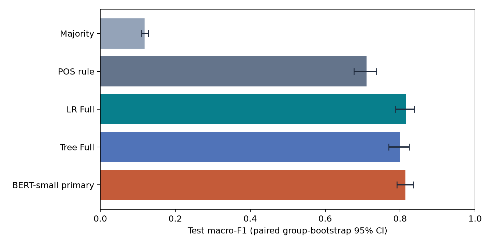
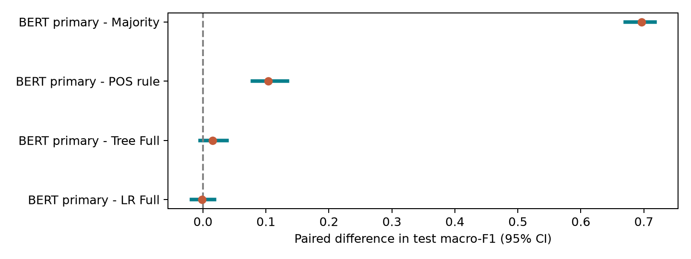
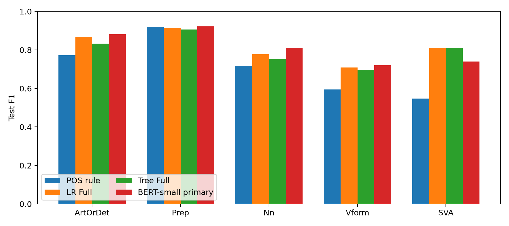

# Presentation: Grammar Error Classification on NUCLE

**Research snapshot:** October 28, 2026. **English Markdown edition:** October 31, 2026.

This replaces the 12-slide Vietnamese presentation PDF. Each section retains the slide's message and translates its speaker notes. Approximate speaking time is 9-10 minutes; no official interview duration was supplied. Contribution statements require individual confirmation rather than inference from this presentation.

## 1. Grammar error classification on NUCLE

**Question:** Given an error location, can a model identify its type?

- 15,788 annotations across five error labels, split by connected essay groups.
- Test Macro-F1: Full LR 0.8163; primary BERT 0.8146.
- Contributor names and individual roles must be confirmed separately.

**Speaker notes (~35 seconds):** Focus on the specific prediction contract: the error span is already known. This is not an automatic error-finding or correction system. The original slides assumed an approximately ten-minute talk; administrative names/IDs and actual contributions remain for the team to confirm.

## 2. Task and three research questions

- Input: original sentence and start/end error offsets.
- Output: ArtOrDet, Prep, Nn, Vform, or SVA.
- RQ1: How well do LR/Tree perform relative to Majority/POS?
- RQ2: How useful are lexical, POS, morphology, and dependency features?
- RQ3: Which errors remain, and under what observed conditions?

**Speaker notes (~45 seconds):** Move from overall performance to input information and remaining mistakes. Gold labels supervise learning; corrections are read only after prediction for analysis and are not predictor inputs. BERT is added later to test another representation under the same task.

## 3. Data and leakage prevention

- Retain 15,788 target annotations from 44,912 annotations in 1,397 essays.
- Train 11,052; validation 2,368; test 2,368.
- Essays connected by checked duplicate content stay in one partition.
- Feature encoder fits on train only; test contains 144 essays in 97 groups.
- ArtOrDet is about 42%, making Macro-F1 necessary alongside accuracy.

**Speaker notes (~50 seconds):** Multiple annotations in one sentence yield related samples. Randomly splitting rows can put related sentences/essays in both train and test. Grouped splitting reduces that problem. The same dependence motivates resampling groups for confidence intervals.

## 4. From data to results: three work areas

1. Data/features: parse SGML, check offsets, split groups, run spaCy, encode S/L/P/M/D.
2. Models: train baselines, LR, Tree, and BERT-small.
3. Evaluation: lock choices, score test, compute CIs, inspect errors, report findings.

LR/Tree consume feature vectors; BERT consumes span-marked sentences.

**Speaker notes (~45 seconds):** These are workflow areas, not confirmed personal assignments. Full LR/Tree use 16,180 feature columns. BERT learns from marked text without concatenating the classical vector. Attribute names only after checking actual work evidence.

## 5. Model design and selection

- LR is multiclass; Tree uses Gini splits with depth/leaf-size limits.
- Validation selects configurations; final models remain fitted on train only.
- Feature removal/masking examines performance changes.
- BERT-small has two layers, hidden size 128, and two attention heads; all model weights are fine-tuned.

**Speaker notes (~45 seconds):** Each feature variant is separately tuned, so its difference is not an isolated causal feature effect at a fixed configuration. POS rule learns signature statistics from train. LR has sentence-wide dependency features; comparison with BERT is not context versus no context.

## 6. From initial BERT to the extension

- Initial pooled CLS, five epochs: validation F1 0.1984 +/- 0.0030.
- Small-set probes show gradient flow and memorization of 100 train samples.
- Extension: two readouts x two head LRs x three seeds = 12 runs, encoder LR 5e-5.
- Evaluate train/validation up to 20 epochs, early-stopping patience 4.
- Readout and training settings both change between phases.

**Speaker notes (~50 seconds):** Memorization probes test optimization, not generalization to unseen essays. The extension restarts from pretrained weights and evaluates the full validation set. Improved results cannot be attributed solely to readout when training duration/head LR also change.

## 7. Select BERT on validation, not the best test seed

| Readout | Head LR | Validation Macro-F1 mean +/- std |
| --- | --- | --- |
| CLS | 1e-4 | 0.7164 +/- 0.0061 |
| CLS | 1e-3 | 0.7227 +/- 0.0147 |
| Span mean | 1e-4 | 0.8183 +/- 0.0011 |
| Span mean | 1e-3 | 0.8177 +/- 0.0022 |

- Select span mean/head LR 1e-4. Primary seed is 20261013, checkpoint epoch 18.
- Three-seed test mean: 0.8182 +/- 0.0038; this std differs from bootstrap CI.

**Speaker notes (~50 seconds):** The same three seeds determine mean validation F1 for each configuration. The primary is fixed, so seed 20261015 cannot replace it merely because its test score is higher. Span mean averages contextual target states after the encoder processes the sentence.

## 8. Test results on the same split

- Full LR 0.8163; primary BERT 0.8146; Full Tree 0.7996; POS 0.7106.
- BERT accuracy 0.8438 exceeds LR 0.8357, while primary Macro-F1 is slightly lower.

**Speaker notes (~50 seconds):** Every point uses the same 2,368 test samples. The BERT point is the locked primary; its seed mean/std is separate. Accuracy weights samples equally, whereas Macro-F1 weights classes equally, explaining different rankings.

## 9. How certain is the difference?

- BERT minus LR: -0.0017, CI95% [-0.0184, 0.0182]; no confident ranking.
- BERT-minus-Tree also contains zero; BERT-minus-POS lies above zero.
- Use 1,000 shared resamples of 97 connected groups.

**Speaker notes (~55 seconds):** Read the CI of the difference, not overlap of separate model CIs. Shared group resamples make the comparison paired. Containing zero indicates insufficient ranking evidence, not proof of equivalence. This bootstrap does not capture new-split or training-seed variation.

## 10. Class-specific strengths and weaknesses

- BERT improves four classes over LR; Nn F1 is 0.8098 versus 0.7781.
- BERT is weaker on SVA: 0.7392 versus LR 0.8106.

**Speaker notes (~45 seconds):** Similar overall F1 hides meaningful tradeoffs. SVA deserves attention because its gap is larger. Predictions alone do not establish attention or parser errors as the cause.

## 11. Error review and inference limits

- Both correct: 1,860; BERT-only correct: 138; LR-only correct: 119; both wrong: 251.
- Inspect 40 selected cases: 12 per disagreement direction, 10 both-wrong, six both-correct controls.
- Missing-word errors can have nonempty spans; some spans are fragments.
- Expert review is pending for some label/correction relationships; gold stays fixed.
- AI-assisted notes neither replace independent adjudication nor estimate corpus prevalence.

**Speaker notes (~50 seconds):** Explain a case personally read on the research machine. ID 38155 is a partial token correctly classified by both models, cautioning against treating all fragments as failures. ID 34539 motivates checking the relationship between label and correction. These are purposeful cases, not a representative random corpus sample; corpus text is not distributed here.

## 12. Conclusions and handover

- Linguistic-feature LR is a strong reference; span-mean BERT is close.
- CIs do not establish BERT superiority over LR; retain both BERT phases.
- New external evaluation is needed for an independent generalization check.
- Public code, aggregate tables/figures, and English Markdown reports support inspection.
- Confirm actual contributions and AI assistance independently of team-wide results.

**Speaker notes (~45 seconds):** Representation and training design matter, but findings do not establish complete grammatical understanding or cross-corpus success. The extension reuses a test already known from classical experiments. Original academic handover reminders do not constitute a submission or contribution confirmation. Follow [RUNNING.md](../../docs/RUNNING.md) for the public workflow.

## Further reading

- [Final project report](final-report.md)
- [BERT comparison](bert-comparison.md)
- [Results index and original aggregate CSVs](../README.md)
